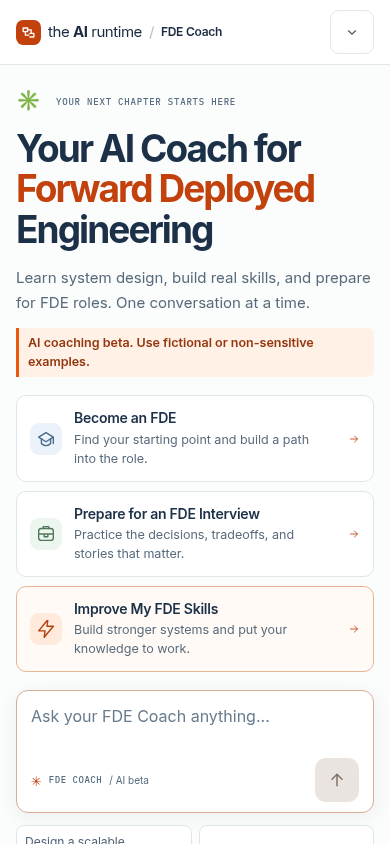
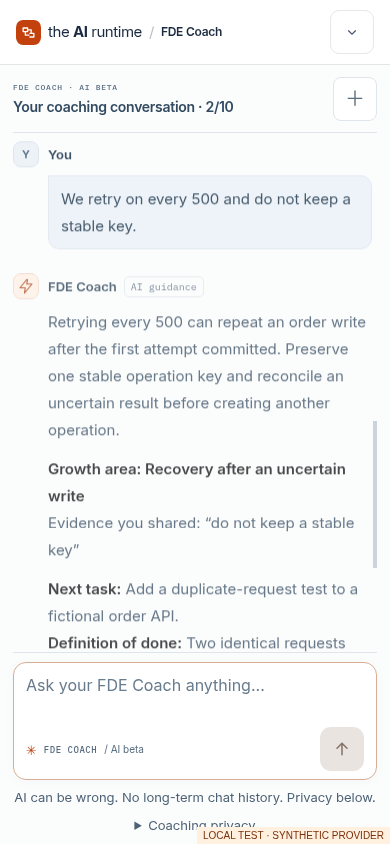
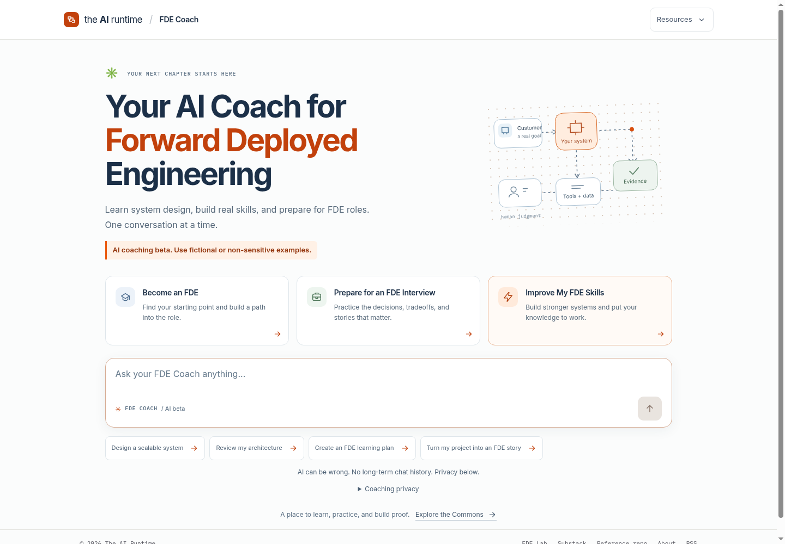
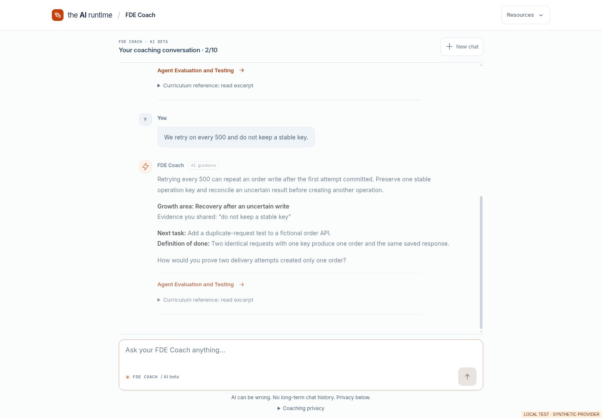

# Synthetic conversation examples

These are authored/local provider fixtures used to exercise the real engine, API, UI, and SQLite security path. They are not measured Workers AI output, real learner data, human-approved gold answers, or evidence of model quality. Screenshots visibly say **LOCAL TEST · SYNTHETIC PROVIDER**. The real provider gate remains closed.

## Practical skills and safe retries

Learner selects **Improve My FDE Skills**.

Coach intake: Which engineering skill would most improve a system you are building now?

Learner: I build .NET APIs and deployed an order service. I want to learn safe retries.

Fixture guidance: Your API experience gives us a concrete starting point. Idempotency separates a logical order operation from its delivery attempts. A stable key can recover the original outcome after response loss.

Coach question: How would you prove two delivery attempts created only one order?

Learner: We retry on every 500 and do not keep a stable key.

Fixture guidance: Retrying every 500 can repeat an order write after the first attempt committed. Preserve one stable operation key and reconcile an uncertain result before creating another operation.

Growth area: Recovery after an uncertain write. Evidence: “do not keep a stable key”.

Next task: Add a duplicate-request test to a fictional order API.

Definition of done: Two identical requests with one key produce one order and the same saved response.

The engine validates quoted evidence, keeps the learner's background in signed bounded state, and separately renders canonical curriculum excerpts. References are verified against the catalog; the model explanation itself still needs correctness review.

## Interview pathway

Learner selects **Prepare for an FDE Interview**.

Coach intake: Which project decision from your own work would you like to practice explaining in an FDE interview?

A subsequent turn can examine the customer outcome, constraint, tradeoff, evidence, and failure recovery of that project. The engine offers a separate explicit Gym link. No interview is silently started, no research consent is assumed, and no readiness score or hiring guarantee is produced.

## Provider failure

A synthetic outage rejects both separately granted model calls. The learner sees **Authored fallback**, useful existing references, and a focused authored question. The UI never labels that response personalized AI. Both failed physical calls remain spent; an exact retry of the saved response does not run them again.

## Screenshots

| Mobile welcome | Mobile conversation |
| --- | --- |
|  |  |

| Desktop welcome | Desktop conversation |
| --- | --- |
|  |  |
