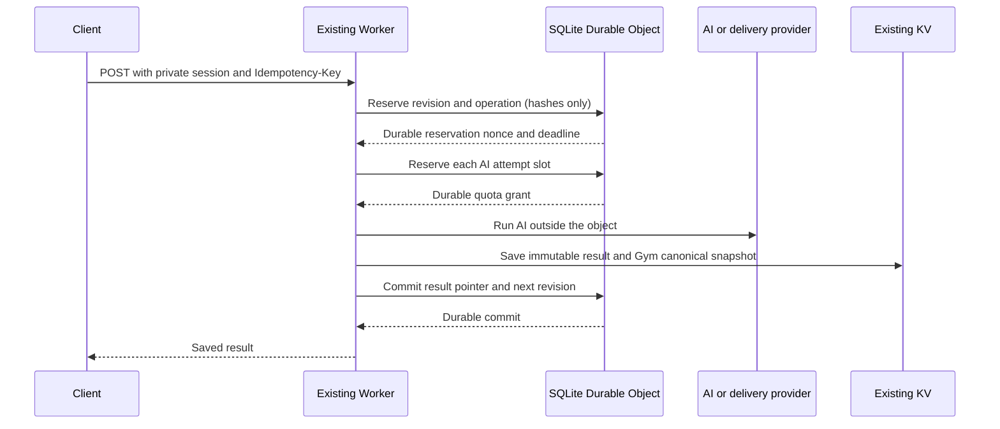

# Coach and Gym security boundary

PR #150 adds one SQLite-backed Durable Object class, `AiSecurityCoordinator`,
exported by the existing Worker. The `AI_SECURITY` binding addresses the single
object named `coach-gym-v1`. It coordinates Coach and Gym only. Models and report
integrations still run in the Worker, outside the object. No D1, separate service,
login system, UI, production secret, or agent framework is introduced.

This is reviewed source and proposed configuration, not a production deployment.
The binding and `v1-ai-security` migration have not been applied to any account.

## Guarantees and storage

The object stores session IDs, hashed capabilities, revisions, turn/attempt
counts, deadlines, request fingerprints, reservation nonces/status, and immutable
KV result pointers. It receives no learner messages, prompts, model output,
architecture graphs, email addresses, or transcripts. IP start buckets use a
SHA-256 hash rotated by hour. These are pseudonymous counters, not anonymous
identity guarantees. They expire after an hour and are cleaned by the hourly
alarm. A missing Cloudflare client IP shares the conservative `unknown` bucket.

Gym conversations remain in the existing consented KV namespace. Each committed
operation has an immutable snapshot and response under `security:result:`;
the coordinator's head pointer selects canonical state. The old mutable
`fde-gym:session:` key is never trusted or adopted. A stale or missing KV value
cannot authorize another mutation or model call. Applications return 503 and
retry the same saved pointer instead of regenerating a missing result.

Coach KV entries retain only the generated reply and signed next state for
idempotent response recovery, not raw learner turns or their stage history.
Generated replies can reflect or quote learner input. This is a new, bounded
three-hour response cache; it is not a promise of zero server retention.
The browser retains at most eight failed request payload/key pairs in memory.
It adds no persistent browser storage or new analytics.

Session metadata and operation records expire at the original session deadline:
three hours for Coach, and the existing Gym retention setting (30 days by
default, bounded to 60 seconds through 90 days). Hourly indexed cleanup removes
expired rows, including counters after the last session is gone. Access checks
reject expired records immediately, without waiting for cleanup or KV deletion.
KV has a minimum 60-second TTL, so a late write can remain briefly after logical
expiry but cannot be served. Cloudflare storage backups/PITR have separate
platform retention; cleanup is not a claim of immediate backup erasure.

## Admission and execution



Report operations omit the AI-attempt step. Their one durable reservation covers
subscription, optional lead webhook, email, and report webhook initiation.

Every admission/check/write sequence runs synchronously in
`storage.transactionSync()`. The storage output gate makes reservations durable
before returning a grant. There is no in-memory mutex or KV read-modify-write
quota. A primary model call and its fallback require distinct one-use slots;
every permitted `AI.run()` invocation is counted, including calls that fail or
return unusable output. Lost admission responses conservatively consume quota.
No attempt is refunded. The code never retries an uncertain admission RPC.

A successful message or finish commits the next session revision. Gym canonical
state is read through the committed immutable head, with a head comparison at
admission to catch concurrent feedback/report updates. Client transcripts,
evaluations, graphs, revisions, timing, and consent cannot replace canonical
state. Coach tokens now include a signed random session ID and revision; old
signed positions cannot roll the session back. Legacy tokens/sessions must
restart. Gym bearer capabilities remain separate from session IDs.

## Start validation before admission

Pure validators shared by the boundary and session constructors validate Coach
lesson IDs and Gym options before contacting the object. Gym consent and
confidentiality acknowledgements must be literal `true`; unsupported enum values,
durations, drills, types, and unknown fields are rejected. Omitted non-consent
options retain their established defaults. Malformed JSON/objects, oversized
requests, and missing private client scopes also fail before admission. These
rejections create no reservations, KV writes, IP counters, or shared daily start
charges. Conflicting idempotency requests and quota denials also leave counters
unchanged through SQLite transaction rollback.

A valid start that is admitted but then encounters infrastructure failure remains
counted conservatively. An uncertain accepted operation is not refunded or
re-executed. This preserves the existing failure and quota guarantees.

## Quotas and bounds

Values are centralized in `src/security/types.ts` and are intentionally explicit
reviewed constants, not new dashboard variables.

| Limit | Value | Reason/behavior |
| --- | --- | --- |
| Shared Coach/Gym AI attempts | 500 per UTC admission day | Conservative cohort cap shared by both apps; every primary and fallback counts |
| Coach session AI attempts | 14 | Physical attempts, not 14 model turns; authored teaching continues when exhausted |
| Gym session AI attempts | 82 | Up to 40 interviewer turns and one evaluator, each with at most one fallback |
| Attempts per operation | 2 | One primary plus one distinct fallback slot; no reusable grants |
| Coach learner turns | 12 | Six authored stages, each with at most one probe |
| Gym candidate turns | 40 | Canonical count is enforced atomically as well as in the route |
| Gym interview duration | 15 or 30 minutes | Server deadline; finishing remains possible until retention expiry |
| Starts | 12 per IP/hour and 200 shared per UTC day | Atomic across both apps; shared NATs share the IP bucket |
| Admitted operations | 64 per session, including start/errors | Bounds idempotency metadata and repeated invalid submissions |
| Reservation lease | 120 seconds, no renewal or reassignment | Expired or uncertain work cannot be executed by a replacement Worker |

Quotas count application-level `AI.run()` admissions, not provider-internal
retries, tokens, neurons, dollars, or completed inferences. A grant issued just
before midnight can start work just after midnight and belongs to its admission
day. Existing per-call output limits remain 400 tokens for Coach, 500 for the
Gym interviewer, and 2600 for the evaluator; payload and transcript bounds limit
input size. These are not an exact billing cap.

When AI is absent, attempts are exhausted, or an attempt RPC fails, the existing
scripted Coach/Gym paths remain available if session admission and commit work.
If the binding, admission, or commit is unavailable, stateful operations return
503/409 rather than bypassing security. Commons static content remains available.

## Idempotency and uncertain outcomes

All stateful Coach/Gym POSTs require a private `Idempotency-Key` header containing
16-128 letters, digits, underscores, or hyphens. The updated clients send UUIDs
and preserve failed requests' keys in memory for retries. Gym omits its ignored
browser timer from message/finish payloads so elapsed UI time cannot change a
retry's identity. API callers must reuse
the same key and exact JSON payload, including property order, to recover a
message result. The same key with changed input returns 409. Start requests also
require a private `X-Session-Client` token (32-128 letters, digits, underscores,
or hyphens). Each API client creates a fresh random token from two UUIDs and
retains it only in page memory. Start operation IDs hash the application, private
client scope, and idempotency key; SQLite receives only hashes. Two different
clients reusing a request key get separate sessions, including behind a shared
NAT or with no client IP header. IP addresses are used only for throttling, never
as credential-replay authority. One client's exact retry can move IP addresses
without changing its result. The private scope plus key is a bearer start receipt,
not a login or identity guarantee; sharing or stealing both allows replay.
Keys/results have session lifetime, not indefinite retention.

Message keys are scoped to their session. Finish, report, and feedback have a
single operation slot each per session, regardless of the supplied key. An exact
repeat returns the saved result; changed content returns 409. This prevents a
fresh request key or changed recipient from authorizing another report delivery.
Invalid report email/consent is rejected before reserving the delivery slot.
Report and feedback update the canonical head without advancing the interview
revision, so the existing result screen can submit both. Feedback is one
submission per interview. There is no client-visible operation lock token.

| Failure point | Safe behavior |
| --- | --- |
| Duplicate while original runs | 409; it receives no execution grant |
| AI grant response lost | Slot remains spent; no duplicate invocation of that slot |
| Primary provider fails | One separately admitted fallback may run; both attempts count |
| KV head missing before Gym mutation | 503 before reservation; retry may succeed when KV becomes visible |
| Worker completes and saves result, but commit request/response is lost | Exact retry can commit the existing pointer within the lease or replay an already committed result; no external work repeats |
| Worker/provider outcome unknown and no saved result exists | 409; no retry execution, quota refund, or lease takeover |
| Lease expires | Session is blocked for new work; late attempts/commits are fenced; restart is required |
| Committed result temporarily absent from KV | 503; retry the same key, never regenerate the response |
| Session expires | 403 even if KV or SQL cleanup has not removed records |
| Object/runtime restarts | Reservations, slots, counters, and revisions survive in SQLite |

A client that discards its in-memory key can lose the ability to recover a
message response and may need to restart. An uncertain initial start can require
a page reload to discard that start's retry key. A model operation taking over
120 seconds can be conservatively abandoned even if it later completes.

Reports provide at-most-once application initiation, not exactly-once delivery.
The API client requires `ok: true` and an explicit boolean acknowledgement from
email or report webhook before resolving. HTTP success alone, malformed JSON,
subscription success alone, pending requests, and uncertain outcomes never show
the accepted state. The existing result panel says "REPORT REQUEST ACCEPTED" and
qualifies that inbox delivery is not confirmed, even after provider acceptance.
It never labels provider acceptance as "REPORT SENT" or "Check your inbox".

After a report reservation, every configured external integration is initiated
at most once. If a response is lost, the provider may have delivered; no automatic
retry, recipient change, or fresh key resends it. A failed or unconfigured report
can therefore remain undelivered for that session. The existing Resend
idempotency header remains defense in depth. Provider-internal duplication and
provider-side transport behavior cannot be guaranteed by this application.

## Infrastructure and costs

The existing TOML adds:

```toml
[[durable_objects.bindings]]
name = "AI_SECURITY"
class_name = "AiSecurityCoordinator"

[[migrations]]
tag = "v1-ai-security"
new_sqlite_classes = ["AiSecurityCoordinator"]
```

`new_sqlite_classes` is Cloudflare's supported migration format for existing
Workers and works with this repository's Wrangler 4 configuration and unchanged
`2025-05-01` compatibility date. It creates a new SQLite class; it does not attempt
to convert a deployed KV-backed Durable Object. There is no new `[vars]` block,
no change to existing KV/AI/assets bindings, and no new secret. Current Cloudflare
docs also describe a newer declarative `exports` format; this PR deliberately
uses the still-supported migration array and does not mix the two formats.

SQLite-backed Durable Objects are available on Workers Free. Current published
allowances include 100,000 DO requests/day, 13,000 GB-s/day, 5 million SQLite rows
read/day, 100,000 rows written/day, and 5 GB stored. Exceeding Free limits fails
operations, which this boundary handles closed. On Paid, DO requests include
1 million/month then $0.15/million; duration includes 400,000 GB-s/month then
$12.50/million GB-s; SQLite includes 25 billion rows read/month, 50 million written,
and 5 GB-month, followed by $0.001/million reads, $1/million writes, and
$0.20/GB-month. A Paid Workers subscription has its own minimum charge.

Expected cohort overhead is small but not zero. Each normal Coach operation
uses admission + commit (two DO requests), plus one request per AI attempt; Gym
also reads the authoritative head (three plus attempts). Starts use two requests.
There is an hourly cleanup alarm while metadata/counters exist. For example,
20 starts and roughly 400 mutations/day with 500 AI attempts are about 1,500
DO requests/day (about 45,000/month), before retries and abusive traffic.
That request volume fits the published Free request allowance; SQL index/write
amplification, other applications' usage, and cleanup still need measurement.
No account billing or current remaining allowance was inspected.

AI, Worker requests, retained KV snapshots/reads/writes, and email delivery retain
their separate costs. Immutable Gym snapshots and reply replay caches add KV
storage proportional to session length and retention. At the maximum 200 starts
and 64 operations per session, deterministic/error requests can exceed Free
KV/SQL write allowances even when AI is capped at 500. Denied and replay requests
also cost DO reads/requests. This is not an account-wide spending cap or a DDoS
control. Keeping AI execution outside the object avoids holding it active for
model latency, but actual object lifecycle/duration and billing should be observed.

References checked against Cloudflare's official documentation source:

- [Durable Object pricing](https://developers.cloudflare.com/durable-objects/platform/pricing/)
- [Published pricing table](https://github.com/cloudflare/cloudflare-docs/blob/production/src/content/partials/durable-objects/durable-objects-pricing.mdx)
- [SQLite storage and creation](https://developers.cloudflare.com/durable-objects/best-practices/access-durable-objects-storage/)
- [Supported migration array](https://developers.cloudflare.com/durable-objects/reference/durable-object-class-migrations-legacy/)

## Deployment and rollback runbook (not executed)

1. Review the complete PR and quota values. Do not merge while review is pending:
   this repository's main-branch Workers Builds pipeline deploys on merge.
2. Run `npm ci`, `npm test`, `npm run check:worker`,
   `npx astro check --root learn`, `npm run build`, `npm run test:report-status`, and
   `npx wrangler@4.160.1 deploy --dry-run --outdir /tmp/air-worker-review`.
   The tests use local workerd/SQLite and stub providers, never production AI,
   retained sessions, email, bindings, or credentials. The optional rendered
   report regression requires Node 22+ and local Chromium (`CHROMIUM_BIN` can
   override its path),
   stubs every API call, and blocks background DNS. It adds no npm dependencies.
3. An authorized operator should check plan allowances and existing environment
   configuration privately. Keep existing secrets in Cloudflare. The current KV,
   AI, assets, and dashboard variables must be preserved. No secret export into
   Codex is needed.
4. If a preview is approved, use a distinct Worker/DO namespace and separate KV
   with stub providers. Do not attach previews to production sessions or quotas.
5. Only after separate deployment approval, deploy through the established
   pipeline. Applying `v1-ai-security` creates the one SQLite class/binding; no
   manual database provisioning or data import is required. Migration creation
   is not a gradual/canary migration. Do not rename the singleton object name.
6. Verify coarse health/configuration, start/message/finish flows, duplicate
   requests, and deterministic fallback in the approved environment. Existing
   sessions require restart; there is no insecure adoption path or data migration.
   Never test report delivery with an unsuspecting recipient.

For rollback, retain the class export, binding, namespace/object name, and
migration history. Roll back to a compatible hardened version or disable only
the affected Coach/Gym routes while repairing. Reverting to the pre-hardening
Worker would restore its replay and authorization vulnerabilities and is not a
safe security rollback. Removing/resetting the binding fails new boundary code
closed, but removing it also prevents normal session operations. Do not delete
or recreate the object, delete migration history, or use SQLite PITR to reset
quotas/reservations: restoring older metadata can erase spent attempts or report
tombstones and re-enable duplicate work. Such data recovery needs a separately
reviewed procedure with these endpoints disabled. Other Commons and AIR routes
can remain served while this boundary is unavailable.

## Scope and verification

The shared `callModel()` implementation and Worker routing logic are unchanged.
Only Coach and Gym wrap `AI.run()` with attempt admission. FDE Path
(`/api/fde-path/*`) and Ask the Library (`/api/ask`) still use the same Workers AI
account outside this boundary and can consume its allowance. Other Workers and
Cloudflare account users can do so too. They are explicitly not covered by the
500-attempt quota. Extending protection to them is a separate scoped change.

Tests exercise actual SQLite-backed workerd objects through Miniflare, including
an actual runtime stop/restart with persisted storage. Test-only clock, counter,
and inspection methods live solely in the test harness and are not exported by
the production Worker. Provider calls run as Worker-side spies/stubs. Coverage
includes concurrent revisions, token replay, duplicate keys, changed payloads,
start/session/daily limits, midnight rollover, expiry, lost grants/commits, KV
failure, provider failure, report deduplication, cleanup, and metadata privacy.

Commons pages, paths, learning content, search, navigation, events/lab host
routing, subscription/intake implementations, shared model behavior, and public
URLs are unchanged. Regression checks cover representative Commons asset routes,
events/lab routing, FDE Path availability, and the shared model client. Full
Astro/Commons builds and type checks validate compilation. This confirms source
and local behavior; it is not a claim of production verification or a live test.
